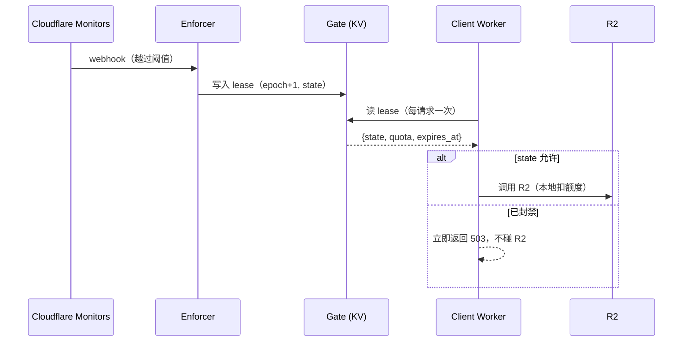

# 让 Worker 自己停止调用 R2：Gate 通信协议

**状态：待实现。** 本文是草案，记录「R2 逼近额度时如何让 Worker 侧也停止调用」的协议设计。当前项目只做监控和告警，没有任何写入操作。

## 为什么需要这个协议

R2 的 REST API 里**没有任何 suspend / disable / pause 端点**。核对过的完整方法清单里只有 `buckets` 的增删改查，加上 `cors`、`domains`、`jobs`、`lifecycle`、`locks` 这些子资源。

Cloudflare 的 Spend Management 也指望不上。官方原文：

> Set spending limits for **Workers and Durable Objects** [...] A Workers limit **does not include** Durable Objects, Workers AI, Workers KV, **R2**, or other products used by your application.

预算告警更明确：

> **Budget alerts are informational only. They do not pause or limit usage.**

所以「自动停止」只能自己造。而在所有可切断的路径里，**Worker 是唯一拦不住的**：

| 路径 | 禁用 API token 能拦住吗 |
| --- | --- |
| 外部 S3 客户端（rclone、aws-cli、备份脚本） | 能。Access Key ID 就是 token 的 ID |
| 自定义域名 / `r2.dev` 公网访问 | 能。关掉 `domains/custom` 或 `domains/managed` 的 `enabled` |
| **绑定了桶的 Worker** | **不能。** `r2_buckets` binding 由运行时注入，不走 Access Key |
| Dashboard 手动操作 | 不能 |

**结论：Worker 这一侧没法从外部切断，只能让 Worker 自己别调。**

## 角色

| 角色 | 职责 | 部署形态 |
| --- | --- | --- |
| **Enforcer** | 读用量、做决策、写 Gate | cron Worker，或本机 `cf-r2-monitor` |
| **Gate** | 保存当前状态 | KV 命名空间（可选 DO 加强一致） |
| **Client** | 业务 Worker，请求入口查一次 Gate | 你自己的 Worker，约 15 行代码 |

数据流是**拉**不是推：Enforcer 只写 Gate，Client 在请求入口读。isolate 随时会被销毁，逐个推送没有意义，能持久化的只有共享存储。



## 租约格式

Gate 里存的值：

```json
{
  "v": 1,
  "epoch": 42,
  "state": "write_freeze",
  "quota": { "a": 0, "b": 250000 },
  "reason": "class_b_88pct",
  "issued_at": 1795651800,
  "expires_at": 1795652100,
  "sig": "base64(hmac-sha256(secret, canonical_json))"
}
```

三个字段承担了协议的全部重量。

### `epoch` 防回滚

KV 是最终一致的，官方原文说写入后其它 PoP 最多需要 60 秒才能看到。这就存在一个窗口：Enforcer 已经写入 `sealed`，某个 PoP 上的 Client 读到的还是旧的 `open`。

Client 在 isolate 内存里记住见过的最大 `epoch`，凡是 `epoch` 更小的值一律丢弃。这比单纯依赖 TTL 可靠。

### `expires_at` 是失效保护

Enforcer 不续租，租约就过期，Client 降级。

**控制面停摆不能等于永久放行。** 这是整个设计里最容易漏掉、又最关键的一条。

### `quota` 是成本摊销

Workers Free 每个请求只有 50 个子请求上限。如果每次 R2 调用都去查一次 Gate，这个额度会直接被打穿。

所以租约里带「额度块」：Client 在 isolate 内存里扣减，块用完才回 Gate 换新的。**N 次 R2 调用只需要 1 次 Gate 读。**

## 状态阶梯

不是只有开和关两档，因为 Class A 和 Class B 的配额差十倍，业务影响也不同。

| state | Class A（写/列举） | Class B（读） | 触发条件 |
| --- | --- | --- | --- |
| `open` | 放行 | 放行 | < 70% |
| `throttle` | 放行但限速 | 放行 | 70–85% |
| `write_freeze` | **拦截** | 放行 | A 侧 85–95% |
| `read_degrade` | **拦截** | 放行，强制走 Cache API | B 侧 85–95% |
| `sealed` | **拦截** | **拦截** | ≥ 95% 或人工 |

Class A 的免费额度是 1,000,000 次，Class B 是 10,000,000 次。**Class A 只有 Class B 的十分之一，更容易被打爆**，所以单独拦。

## 故障语义

这一节决定方案是否真的可用。

| 情形 | 行为 |
| --- | --- |
| 读成功、签名有效、未过期 | 严格执行 |
| 签名无效 / `epoch` 更低 | 丢弃，沿用上次有效值，并告警 |
| 读失败（5xx、超时） | 沿用本地缓存，直到 `LOCAL_GRACE`（建议 60 秒） |
| 本地也没有缓存 | 按配置，**默认 `write_freeze`** |
| 租约过期（控制面挂了） | 同上，并升级告警 |
| 未知 `v` / 未知 `state` | 按 `sealed` 处理 |

默认选 `write_freeze` 而不是 `sealed` 的理由：挡住读会让业务整体不可用，挡住写多数场景还能降级；而且 Class A 的配额本来就更容易被打爆。

## 必须遵守的约束

- **Gate 读只能放在 handler 顶部，禁止在循环里读。** 这不是性能建议，是协议强制项。Free 计划 50 子请求的上限会被打穿。
- **本地缓存 TTL 建议 10 秒。** KV 侧 `cacheTtl` 最小 30 秒，两层叠加后实际刹车延迟 = 60 秒传播 + 一个评估间隔。
- **恢复不能自动放开。** `sealed` 解除需要连续 N 次评估低于阈值（建议 N=3），否则会抖动。

## 两条触发链路

| 链路 | 粒度 | 作用 |
| --- | --- | --- |
| **Cloudflare Monitors → webhook → Enforcer** | 服务端约 1 分钟 | 快速刹车，本机离线也能触发 |
| **`cf-r2-monitor` cron** | 由 timer 决定 | 精确判定与恢复，GraphQL 能分 Class A/B、能算 GB-month |

两条链路写同一个 Gate，靠 `epoch` 排序，谁新听谁的，天然不会互相覆盖。

### 关于 Monitors

Monitors 在 Cloudflare **服务端**按计划执行一条 SQL API 查询，结果满足条件就发通知。所以它比自建轮询更靠上游，而且不依赖你自己的机器在线。

自定义 SQL 的硬性要求：

- 必须返回**单个数值列，且列名为 `value`**
- 只读一个 schema 限定数据集
- 必须带 account / zone 过滤
- 不能有尾分号

R2 在 SQL 数据集目录里确实存在，实测拿到两个：

| 数据集 | 说明 | 关键列 |
| --- | --- | --- |
| `states.r2CombinedStorage` | R2 Storage | `accountTag`、`bucketName`、`payloadSizeBytes`、`metadataSizeBytes`、`objectCount`、`usageReportTimestamp` |
| `events.r2CombinedOperations` | R2 Operations | `accountTag`、`bucketName`、`actionStatus`、`httpStatus`、`objectSizeBytes`、`timestamp` |

三个实测出来的坑：

**`states` 数据集只允许 `MAX` 聚合。** 用 `SUM` 会报：

```
unsupported expression: SUM is not a valid aggregation for this States dataset (in value); allowed aggregations: MAX
```

所以总存储要写成 `SELECT MAX(payloadSizeBytes + metadataSizeBytes) AS value ...`。

**`time_range` 必填。** 不带会报 `HTTP 422 ... query must include a time range`。

**存储观测精度是 30 分钟一个点**，不是实时的。

还有一点：`events.r2CombinedOperations` **没有 `actionType` 列**，GraphQL 的 `r2OperationsAdaptiveGroups` 才有。所以在 SQL 里区分不了 Class A 和 Class B，这也是为什么精确判定仍然要靠 GraphQL。

**Monitors 没有公开 REST API**（`/accounts/{id}/alerting/v3/monitors` 等三个路径都返回 404），只能在 Dashboard 手动建。

## 这个协议解决不了什么

- **拦不住 Dashboard 手动操作。**
- **拦不住没接入 Client 代码的 Worker。** 协议是自愿遵守的，没有强制力。
- **超发上界不可控。** 同时存活的 isolate 数量未知，所以「已发放但未消耗」的额度可能有 `块大小 × isolate 数` 的偏差。块取小一点，偏差就小。
- **KV 传播延迟 60 秒是硬下限。** 从越过阈值到真正停住，最坏要一个传播周期加一个评估间隔。

## 待定决策

| 问题 | 候选 |
| --- | --- |
| `fail_open` 默认值 | `write_freeze`（推荐）/ `open` / `sealed` |
| 额度块大小 | 日配额的 0.1%（省读、易超发）↔ 1%（保守、费读） |
| Gate 是否加 DO | KV 够用但慢；DO 强一致但每次检查 +1 子请求 |
| HMAC secret 怎么发 | Worker Secret binding，每个 Client 一份 |
| Client 接入方式 | 手写约 15 行 / 提供 `@mooling/r2-gate` 小包 |

## Client 侧用什么语言写

官方认定的一等支持是 JavaScript、TypeScript、Python（Pyodide）、Rust（`workers-rs`，编译到 Wasm），其余走 WebAssembly。

**推荐 TypeScript。** 理由只有一条：Gate 检查在每请求热路径上，必须足够轻，不能自己变成瓶颈。Rust 的好处是能和 `cf-r2-monitor` 共用类型定义；Python 走 Pyodide，多一层解释执行，不适合；Wasm（C/C++/Go）除非已有现成模块。

## 待实现事项

- [ ] 决定 `fail_open` 默认值与额度块大小
- [ ] 用 TypeScript 写 Enforcer 与 Client 的最小 PoC
- [ ] 定义 HMAC 签名的规范化 JSON 序列化规则
- [ ] 在 Dashboard 建 Monitors，指向 Enforcer 的 webhook
- [ ] 让 `cf-r2-monitor` 支持写 Gate（新增输出后端）
- [ ] 压测：确认 50 子请求上限下额度块够用
- [ ] 写恢复流程文档（人工解封怎么做）

## 参考

- <https://developers.cloudflare.com/r2/api/tokens/>（Access Key ID 就是 token ID）
- <https://developers.cloudflare.com/r2/platform/limits/>
- <https://developers.cloudflare.com/notifications/monitors/>
- <https://developers.cloudflare.com/analytics/sql-api/>
- <https://developers.cloudflare.com/workers/wrangler/configuration/>（`r2_buckets` binding）
- <https://developers.cloudflare.com/workers/languages/>
